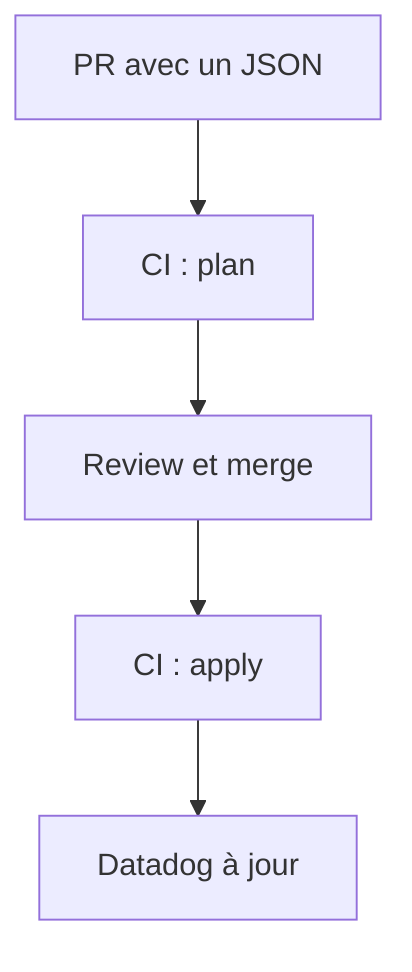

# Datadog en Terraform (dashboards et monitors)

Les dashboards (`../dashboards/*.json`) et les monitors (`../monitors/*.json`) sont déclarés en Terraform : un fichier JSON déposé dans le dossier devient un objet Datadog, sans toucher aux fichiers `.tf`.

## Comment ça fonctionne



- `main.tf` boucle sur les fichiers avec `for_each = fileset(...)`. La clé de chaque ressource est le nom du fichier (par exemple `overview.json`).
- Le state (la liste de ce que Terraform a créé) est stocké dans **HCP Terraform**, pas dans git. Sans lui, chaque exécution de la CI recréerait tous les objets en double.
- Terraform s'exécute dans **GitHub Actions** (workflow `.github/workflows/terraform-datadog.yaml`). HCP ne fait que garder le state.
- Le sens est unique : le dépôt gagne. Une modification faite dans l'interface Datadog sera écrasée au prochain `apply`.

## Mise en place (faite une fois)

### 1. HCP Terraform

1. Organisation : `Volontariapp`.
2. Workspace : `Volontariapp-deploy`, de type pilotage par la ligne de commande (CLI-driven).
3. Settings > General > **Execution mode : Local**. Sans cela, HCP exécute Terraform lui-même, n'a pas les clés Datadog et le `plan` échoue avec `credentials are required unless validate = false`. Le mode par défaut du projet est Remote : il faut le changer explicitement et enregistrer.
4. Settings > General > Remote state sharing : **Share with specific workspaces**, sans en ajouter (moindre privilège, aucun autre workspace n'a besoin de lire ce state).
5. Jeton : page Tokens du compte, **Create an API token**. Ce jeton agit avec les droits du compte qui l'a créé.

### 2. Clés Datadog

Dans Datadog, Organization Settings :

- une **API key** dédiée (nom conseillé : `terraform-deploy`), distincte de `k8s-agent` qui sert à l'agent du cluster ;
- une **Application key** avec les droits d'écriture sur les monitors et les dashboards.

Le site est `us5` : l'URL de l'API est `https://api.us5.datadoghq.com/` (variable `datadog_api_url` dans `provider.tf`).

### 3. Secrets GitHub du dépôt `deploy`

Les valeurs sont saisies par la personne concernée, jamais écrites dans un fichier ni dans une conversation. La commande demande la valeur en saisie masquée :

```bash
gh secret set DD_API_KEY -R Volontariapp/deploy
gh secret set DD_APP_KEY -R Volontariapp/deploy
gh secret set TF_API_TOKEN -R Volontariapp/deploy
```

| Secret | Contenu | Lu par |
| :--- | :--- | :--- |
| `DD_API_KEY` | API key Datadog | le provider Datadog |
| `DD_APP_KEY` | Application key Datadog | le provider Datadog |
| `TF_API_TOKEN` | jeton API HCP Terraform | `hashicorp/setup-terraform`, pour se connecter au workspace |

Vérification : `gh secret list -R Volontariapp/deploy` doit afficher les trois noms.

### 4. Variable de dépôt `TF_APPLY_ENABLED`

L'`apply` automatique au merge est **coupé par défaut**. Il ne s'active qu'avec la variable de dépôt `TF_APPLY_ENABLED` à `true` (Settings > Secrets and variables > Actions > Variables, ou `gh variable set TF_APPLY_ENABLED --body true -R Volontariapp/deploy`). À faire **après** l'import des objets existants (section suivante), jamais avant.

## Ajouter, modifier, supprimer

| Action | Geste |
| :--- | :--- |
| Ajouter un dashboard ou un monitor | déposer `nouveau.json` dans `../dashboards/` ou `../monitors/` |
| Modifier | éditer le JSON |
| Supprimer | supprimer le fichier : au prochain `apply`, l'objet est **détruit dans Datadog** |

Lire le résultat du `plan` dans la PR avant de merger : c'est lui qui annonce les créations, modifications et destructions.

Test en local (clés saisies sans les écrire dans un fichier) :

```bash
read -rs DD_API_KEY && export DD_API_KEY
read -rs DD_APP_KEY && export DD_APP_KEY
terraform login
terraform init
terraform plan
```

## Rattacher les objets déjà présents dans Datadog (import)

Un objet créé à la main avant Terraform n'est pas dans le state. Le premier `plan` annonce alors `N to add` et un `apply` créerait un **doublon**. Il faut rattacher chaque objet existant avec `terraform import`, en donnant la clé de la ressource et l'identifiant Datadog (lu dans l'URL du dashboard ou du monitor) :

```bash
terraform import 'datadog_dashboard_json.all["overview.json"]' <id-du-dashboard>
terraform import 'datadog_monitor_json.all["redis-streams-dlq.json"]' <id-du-monitor>
```

Les guillemets simples protègent les crochets et les guillemets de la clé dans le shell. Critère de réussite : `terraform plan` affiche `0 to add` (les modifications éventuelles sont à lire une à une : un écart de format entre le JSON du dépôt et celui de Datadog peut apparaître).

Alternative sans import : supprimer l'objet dans Datadog et laisser Terraform le recréer. Il reçoit alors un nouvel identifiant : l'URL du dashboard change, il disparaît de la Dashboard List de la status page (à ré-ajouter) et un monitor perd son historique.

Objets à supprimer dans Datadog avant le premier `apply`, un par fichier du dépôt (chercher par titre, ne toucher à aucun autre objet, ne garder aucun doublon) :

| Fichier | Titre ou nom |
| :--- | :--- |
| `dashboards/overview.json` | Vue d'ensemble - Plateforme (Santé, Débit, Latence, Erreurs) |
| `dashboards/infra-db.json` | Infrastructure & Bases de Données (Kubernetes, PostgreSQL, Redis, Stockage) |
| `dashboards/storage.json` | Métier & Stockage de Fichiers (Activité Produit, ms-storage, Scans & Médias) |
| `dashboards/request-flow.json` | Flux des Requêtes (api-gateway, ms-*, Outbox, Post-Processors, Workers) |
| `dashboards/async-flows.json` | Flux Asynchrones (Outbox, BullMQ, Redis Streams & DLQ) |
| `monitors/redis-streams-dlq.json` | [Volontariapp] DLQ Redis Streams non vide ({{stream.name}}) |
| `monitors/redis-streams-pending.json` | [Volontariapp] Messages en attente Redis Streams ({{stream.name}} / {{group.name}}) |

Une modification faite dans l'interface sur ces objets depuis leur import est perdue : le JSON du dépôt fait foi.

## Brancher une notification Discord sur un monitor

Un monitor prévient par des mentions `@...` écrites dans son champ `message`. Sans mention, l'alerte se déclenche dans Datadog mais personne n'est notifié. Les deux monitors actuels n'en ont aucune.

1. Dans Datadog, créer l'intégration (webhook Discord) une seule fois. L'URL du webhook est un secret : elle reste dans Datadog et n'entre jamais dans le dépôt.
2. Relever le handle que Datadog donne à cette intégration (de la forme `@...`, à lire dans l'interface).
3. Ajouter ce handle au champ `message` du JSON du monitor **dans le dépôt**, par exemple dans le bloc `{{#is_alert}}...{{/is_alert}}`. Le handle n'est pas un secret.
4. Ouvrir une PR : le `plan` annonce `1 to change`, puis l'`apply` met le monitor à jour sur place, sans le recréer.

À ne pas faire : ajouter la mention dans l'interface (elle est écrasée au prochain `apply`) ou copier le JSON exporté depuis Datadog (il contient des champs que le fichier du dépôt n'a pas, et cause des écarts permanents au `plan`). Un nouveau monitor porte sa mention dans son JSON dès la création.

## Dépannage

| Message | Cause | Correction |
| :--- | :--- | :--- |
| `Running plan in HCP Terraform` puis `credentials are required unless validate = false` | workspace en Remote | passer l'Execution mode en Local et enregistrer |
| `N to add` alors que les objets existent déjà | objets non importés | section import ci-dessus |
| `plan` en échec sur `init` | `TF_API_TOKEN` absent ou expiré | recréer le jeton, `gh secret set TF_API_TOKEN` |

## Limites connues

- Le comportement des `id` de widgets dans les dashboards n'est pas vérifié : un écart permanent au `plan` après import est possible.
- Les droits exacts nécessaires à l'Application key n'ont pas été vérifiés dans la documentation Datadog.
- Le jeton HCP actuel est un jeton utilisateur : un jeton limité au workspace serait préférable à terme.
